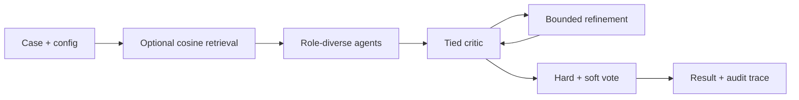

# NeuroPanel

**Research inference architecture for neurology-domain language-model assistance.**

[中文说明](README.zh-CN.md) · [Architecture](docs/inference_architecture.md) · [Run guide](docs/run_reference.md) · [Model card](MODEL_CARD.md)

## Release status

This repository now includes a **runnable reconstructed reference implementation** of the retrieval → multi-agent generation → critique → refinement → voting architecture described in Supplement 3 of *Neurology-domain large language model assistance for physician diagnosis: a randomized controlled trial*.

**The reference implementation was newly written in October 2026. It is not authenticated original-trial code and has not reproduced the primary study results.** Example roles, prompts, thresholds, and decoding settings are explicitly labeled reference choices. The original study configuration, final checkpoint, calibration evidence, and clinical evaluation materials remain pending.

## Quick start — no model or credentials required

Python 3.10+, from this repository root:

```sh
PYTHONPATH=src python3 -m neuropanel \
  --config configs/reference.demo.json \
  --case examples/reference_case.json \
  --bank examples/reference_bank.json \
  --output outputs/demo-run-001
```

This is a deterministic synthetic demonstration. It exercises retrieval, two agents, critique, refinement, voting, and trace recording with mock responses. It does not run DeepSeek or validate clinical performance.

For a real model endpoint, see the [run guide](docs/run_reference.md). The HTTP adapter connects to an existing OpenAI-compatible server; model serving and weight loading are separate prerequisites.

## Architecture



See the [detailed architecture](docs/inference_architecture.md) for schemas, equations, tie/duplicate handling, exclusions, failure behavior, and the distinction between manuscript descriptions and new engineering choices.

## Contents

| Location | Contents |
| --- | --- |
| `src/neuropanel/` | Controller, HTTP/mock backends, retrieval, schemas, voting, CLI |
| `prompts/reference/` | Newly written generation, critic, and refinement prompts |
| `prompts/revision_single_model_comparator.txt` | Preserved comparator prompt, separate from reference runner |
| `configs/reference.*.json` | Runnable synthetic and HTTP examples; not trial settings |
| `configs/study.template.json` | Unknown historical settings remain null |
| `examples/` | Synthetic inputs, demonstration bank, expected result |
| `tests/` | Synthetic behavioral and HTTP contract tests |
| `docs/` | Architecture, run guide, data availability, reproducibility and release checklist |
| `weights/` | Artifact release instructions and manifest template |

## Verification and limitations

The offline pipeline and local HTTP contract tests have been executed. A real model-server run and clinical adjudication are not verified by this release. Scores are explicitly uncalibrated model self-reports. Retrieval filters do not establish complete training/test independence. The single-agent control is not automatically budget matched to the full workflow.

```sh
PYTHONPATH=src python3 -m unittest discover -s tests -v
```

## Data and model availability

Patient data, clinical run logs, and restricted retrieval resources are not included. See [data availability](docs/data_availability.md). Real-case traces may contain sensitive content and must remain outside public Git history.

The separately prepared DeepSeek Q8_0 artifacts are upstream base-model parameters, not final NeuroPanel weights. Check [Releases](https://github.com/beginluckyelegant-sys/NeuroPanel/releases) for actual asset availability; the inference source release does not assert completion of the earlier weight-upload job.

## Citation, licensing and contributions

Formal manuscript citation metadata and software licensing remain pending rights-holder confirmation. Until a license is selected, repository visibility does not itself grant an open-source license. Third-party model terms remain applicable. Cite the repository URL and exact commit when referencing these materials. See [CONTRIBUTING.md](CONTRIBUTING.md).
