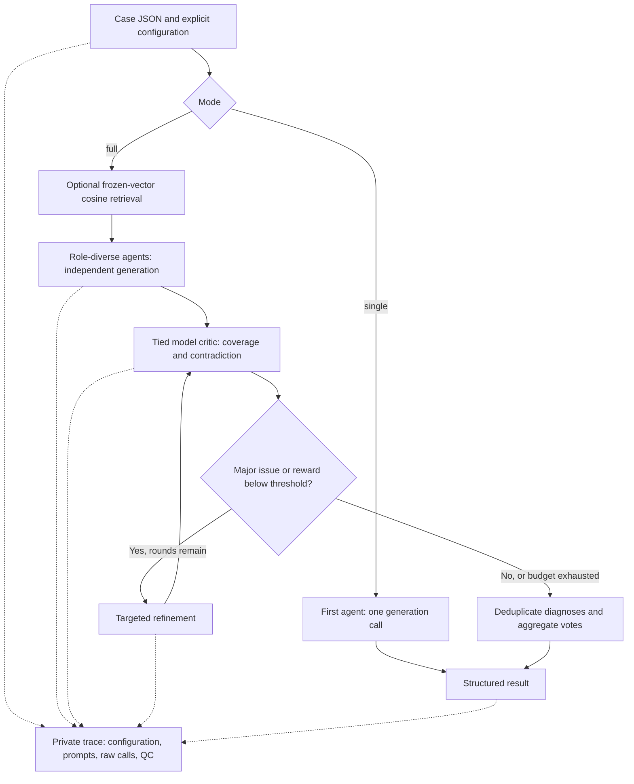

# Inference architecture

**Implementation status:** runnable, newly reconstructed reference implementation (2026-10-11). It implements the high-level inference stages described in Supplement 3, eMethods 2. This version documents the executable workflow, example settings, and synthetic software validation.

## Modules and interfaces

| Module | Responsibility |
| --- | --- |
| `src/neuropanel/__main__.py` | CLI, explicit inputs, exclusive output directory, private result/trace files |
| `src/neuropanel/backend.py` | OpenAI-compatible HTTP chat adapter; deterministic mock backend |
| `src/neuropanel/pipeline.py` | Controller, generation, tied critic, bounded refinement, failure trace |
| `src/neuropanel/retrieval.py` | Frozen-vector cosine ranking and explicit exclusion filters |
| `src/neuropanel/schema.py` | Structured diagnosis and critic validation |
| `src/neuropanel/voting.py` | Canonicalization, hard and soft votes, tie handling |

## Stage definitions

### 1. Retrieve and orchestrate

The optional demonstration bank and query must carry the same nonempty `embedding_revision`. Embeddings are supplied by the caller; this implementation does not train or call an embedding model. Real deployments must produce them using the same frozen model and preprocessing. Demo vectors are hand-authored synthetic vectors, not semantic embeddings.

Cosine similarity ranks eligible demonstrations. Entries are excluded for a matching case identifier, configured evaluation identifier, matching non-null patient/group identifier, or normalized identical text. Ties sort by case identifier. These filters do not establish full patient-level independence or exclude semantic paraphrases when identifiers are absent. A separately audited bank is still required.

Each agent receives the same retrieved examples and case but its own role, temperature, and consideration-order instruction. Supplied candidate choices are deterministically shuffled and optionally reversed; for open-ended cases without choices, ordering diversity is prompt-based only. Agents execute sequentially and independently before aggregation. Sequential execution is the scheduling choice in this reconstruction.

### 2. Generate

Output contains four fields: `symptom_analysis`, ranked `differential_diagnosis`, `further_tests`, and `final_conclusion`. Each differential entry has a name and a self-reported score in [0,1]. The prompt requests a concise evidence-based justification. No private internal reasoning is requested or assumed available.

All agent and critic calls use the configured served model. The adapter sends explicit temperature, top_p, max_tokens, and a per-call seed derived from the run seed. It does not establish that the endpoint honors the seed, fits the full context, uses a particular checkpoint, or is deterministic across platforms. Model identity must be checked separately against the serving environment.

### 3. Critique and refine

The same served model supplies four coverage values and a contradiction penalty. Reward is:

`R = sum(section_weights[i] * coverage[i]) - penalty_weight * contradiction_penalty`.

Refinement occurs when the critic flags a major issue or the reward is below the configured minimum. Every refinement is re-critiqued. At the configured maximum, the last structurally valid answer is retained and unresolved issues are explicitly reported. This last-answer policy is a new reference choice and must be compared with historical behavior before trial equivalence is claimed.

### 4. Vote

For each unique canonical diagnosis `d`:

`vote(d) = number_of_agents_with_d_in_top_k + soft_weight * sum(agent_self_report(d))`.

Aliases use a caller-reviewed one-hop mapping; no automatic clinical synonym judgment is performed. Within an agent, duplicate canonical diagnoses receive one hard vote at most and use their maximum reported score. Unique order preserves the first occurrence. Missing diagnoses contribute zero soft score. Ties break by total score, then hard count, then canonical name. Mean self-reported score divides by all participating agents, including missing diagnoses as zero.

These are **uncalibrated self-reported scores**, not diagnostic probabilities. The code does not implement, fit, or assert the manuscript's historical temperature calibration or ECE results. A separate held-out calibration dataset and verified historical procedure are required for those claims.

## Failures, budgets, and traces

Malformed JSON, missing fields, nonfinite/out-of-range scores, truncation, and non-stop completion reasons fail the case and retain the raw response in the trace. Such failures are not silently regenerated or excluded from evaluation. Optional transport retries apply only to network failures or specified transient HTTP codes; successful responses report the attempts. A timed-out call may already have executed on the server, so server-side token/call accounting remains necessary.

Maximum successful calls in full mode are `M * (2 + 2 * max_refinements)`; single mode makes one call. Transport retries can increase server requests. Per-call token limits are caps, not matched total budgets between modes. Therefore the single mode is a software control path, not a validated budget-matched clinical ablation.

`trace.json` contains exact prompts and requests, returned response objects/usage when supplied, per-call elapsed time, settings, content hashes, retrieval matches, critic reviews, and output status. It can contain sensitive input text. Output directories and files are private by default and ignored by Git. Do not commit real-case traces.

## Evidence boundary

| Item | Evidence in this release |
| --- | --- |
| Retrieval/controller/critic/refinement/voting mechanics | Implemented and tested with synthetic fixtures |
| HTTP request/response adapter | Tested against a local synthetic HTTP server |
| Full synthetic run | Executed; 2 agents, 8 mock calls, including refinement |
| Execution validation | Synthetic fixtures and a local HTTP contract server |
| Agent roles, prompts, thresholds, budgets | Configurable examples introduced in this reconstruction |
| Model preparation | Externally supplied checkpoints and serving environment |
| Score interpretation | Uncalibrated model self-reports; clinical evaluation is a separate workflow |
| Study comparison inputs | Versioned artifacts and adjudication/evaluation materials documented separately |
